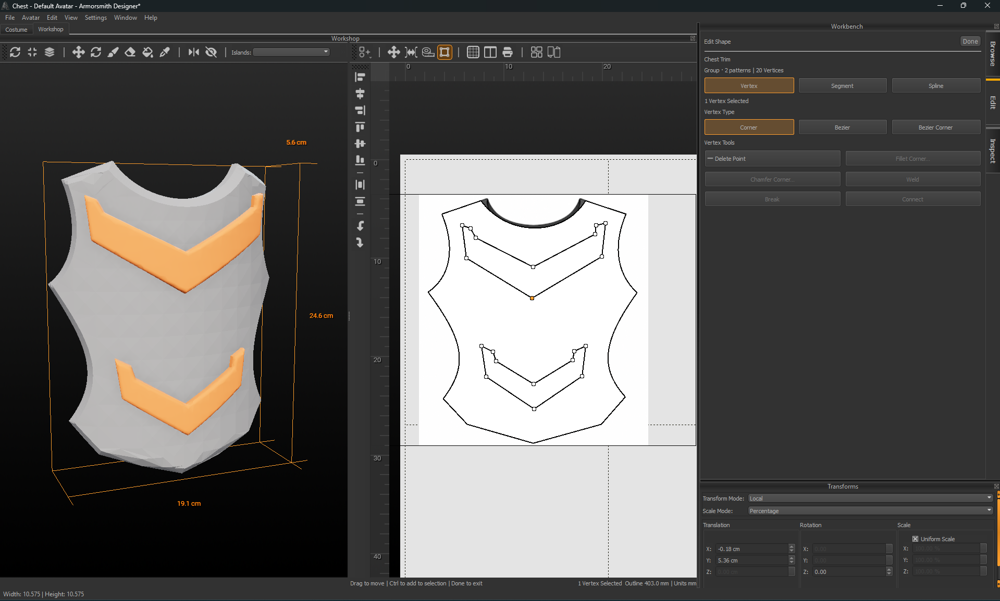

<Info>
These instructions are for **Armorsmith Designer 2.1.1.0**. Earlier versions, including 2.1.0.10, can show different panels and labels.
</Info>

Draw the flat outline first, then refine it before giving it thickness. A simple bracer or trim panel is easier to edit when it uses only a few corners and curve changes.

## Create and promote an outline

1. Open Workshop and select a workspace.
2. Open **Create** above the pattern view and choose **Line**, **Rectangle**, or **Circle**.
3. Complete the shape in the 2D view. For a free outline, place a few anchors and close the path when ready.
4. Select it and use **Edit Shape** for further changes.
5. When the outline is closed and encloses a valid area, right-click it and choose **Promote To Foam Pattern**.
6. Open **Edit Foam** to set thickness and forming.

Creating an outline alone does not make a solid foam piece. Open or self-crossing outlines cannot form a valid solid.

## Choose what to edit

*Edit Shape provides Vertex, Segment, and Spline selection levels, including grouped outlines.*

In Workbench Edit, choose the appropriate selection level:

| Selection | Use it for |
| --- | --- |
| **Vertex** | Anchors, handles, and individual corners. |
| **Segment** | A section of the outline between anchors. |
| **Spline** | The outline as a whole. |

Tools change with the selection level. Select the intended target before applying an operation. **Ctrl** adds to selection. Use **Done** to finish editing.

## Refine anchors and curves

Use **Corner**, **Bezier**, or **Bezier Corner** for the selected vertex. Straighten or curve the intended segment rather than adding extra anchors to approximate a curve. **Add Point** inserts a vertex on a segment without changing that curve. **Delete Segment** removes selected segments while keeping the remaining pieces.

**Break** separates a segment into independent endpoints and keeps Edit Shape active. **Connect** joins two open endpoints with a straight segment. Breaking or opening a foam outline can remove its solid preview until you close it again.

## Round or chamfer a flat corner

In updated builds, **Edit Shape → Vertex Tools** offers **Fillet Corner…** and **Chamfer Corner…** for one or more selected corners on the same outline.

- **Fillet Corner…** creates a rounded corner from a radius in millimetres.
- **Chamfer Corner…** cuts across the corner at a distance measured along each adjoining curve.

Drag from the corner marker to preview the change, or right-click a marker for an exact value. A value that cannot fit the selected corners is rejected. These tools require uniformly scaled outlines.

See [Create shapes and finish corners](/patterns/shape-creation-and-corners#round-corners-with-fillet) for the full workflow. A 2D chamfer changes the cut outline; [Edge Finish](/foam-preview/edge-style) shapes the 3D foam thickness edge.

## Trim, extend, or offset

- **Trim** removes a clicked portion between crossing paths. Provide a crossing boundary in the same workspace.
- **Extend** starts from an open endpoint and follows its tangent to a crossing path.
- **Offset Outline…** creates a separate outline at an entered distance in millimetres. Inspect tight or concave corners. If the offset collapses or crosses itself, reduce the distance; the original remains unchanged.

Press **Escape** to finish a click-based construction operation. Use **Edit → Undo** if the result is unsuitable.

## Reuse a design

Right-click an outline for **Create Instance** or **Create Mirrored Instance**. Linked instances share outline edits but retain their own placement. Use **Make Unique** before making an outline change that should affect only one copy.

**Enable Live Symmetry** links the outline's symmetric construction. **Bake Symmetric Outline** turns that relationship into a complete outline for independent editing. These commands differ from mirroring an attached part on the avatar.

## Set physical dimensions

Select a supported rectangle, circle, or ellipse and use [Inspect](/interface/property-grid#set-shape-dimensions) for Width/Height or Radius. Recheck layer containment after resizing a raised piece.

Keep the flat cut outline separate from the [formed preview](/foam-preview/thickness-and-forming). A 2D corner chamfer changes the outline; [Edge Finish](/foam-preview/edge-style) changes the thickness edge in 3D.
