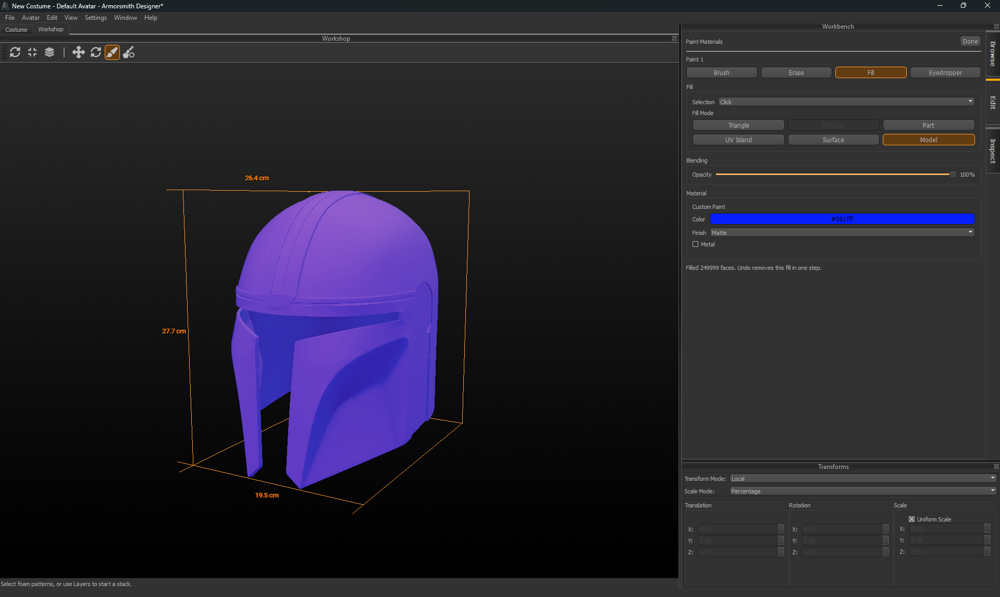

<Info>
This tutorial is a draft for the **Armorsmith Designer 2.1.2.0** painting release. See the [Paint tool reference](/painting/paint-materials) for every control.
</Info>

In this exercise, you will give a simple 3D armor part a neutral base color, paint a contrasting accent, and use separate Paint Passes so the details remain easy to edit.

You need a costume with one imported 3D model in a workspace. A helmet, gauntlet, or chest piece with broad visible surfaces is a good practice model.

## 1. Open the model in Workshop

1. Open your costume, or choose **File → Import** to add a model.
2. Switch to **Workshop**.
3. Under **Workbench → Browse → Workspaces**, choose the workspace containing that model.
4. Orbit the 3D view and make sure the area you want to paint is visible.

**Check:** The model is visible in the 3D side of Workshop. You are editing the source model, not moving an attached copy around the avatar.

## 2. Start Paint Materials

1. Click **Paint Materials** in the toolbar above the model.
2. Find the painting controls under **Workbench → Edit**.
3. If **Preparing Materials** appears, let it finish before painting.
4. Open **Browse → Material Passes** and select the first Paint Pass (often **Paint 1**). If the stack has none, choose **Add Pass → Paint Pass**.

**Check:** The selected Paint Pass is visible, and **Brush**, **Erase**, **Eyedropper**, and **Fill** are available in Edit.

## 3. Apply a base color with Fill

1. In Edit, under **Material**, choose a neutral **Color** (for example, medium gray).
2. Set **Finish** to **Satin**, and leave **Metal** off for a nonmetallic painted base.
3. Choose **Fill**, set **Selection** to **Click**, and select **Model** under **Fill Mode**.
4. Point at the model and click to apply the base paint.
5. Orbit around the model and inspect the result.

**Check:** The paintable model has a consistent base color. If you only want a section colored, use **Surface** and adjust **Edge Threshold**, or try **Part** rather than filling the entire model.

*Example: a whole-model fill. Your chosen color can be different.*

## 4. Add a detail Paint Pass

1. Open **Browse → Material Passes** and choose **Add Pass → Paint Pass**.
2. Rename the new pass to **Accent** by double-clicking its name.
3. Keep **Accent** selected and visible.
4. Under **Material**, choose a contrasting paint color. For a painted metallic trim, enable **Metal** and choose an appropriate **Finish**.
5. Select **Brush**.

The accent pass sits above the base, so you can remove or adjust the accent without painting over the underlying base.

## 5. Brush on the details

1. Start with a simple **Brush** stamp.
2. Set **Size** for the width of the area you want to color. Press **[** to decrease size and **]** to increase it.
3. Set **Flow** to about **40%**, **Stroke Opacity** to **100%**, and **Spacing** to **10%** as a starting point.
4. Drag a short stroke over a visible edge, raised feature, or trim area on the 3D model.
5. Add another stroke if you want stronger coverage. Orbit and continue around the part.

**Check:** The detail appears on the Accent pass without replacing the base color everywhere else. Adjust brush size and flow to suit your model.

<Tip>
If you need crisp coverage across a clearly separated section, try **Fill → Surface** with a suitable **Edge Threshold**, rather than painting its entire area by hand.
</Tip>

## 6. Correct a mistake without losing the base

1. With **Accent** still selected, choose **Erase**.
2. Reduce **Size** as needed and brush over the unwanted accent.
3. Switch back to **Brush** to refine the edge.

Erase removes coverage from the active Paint Pass, revealing the base pass underneath. It does not delete mesh geometry.

To reuse an existing paint color and finish, choose **Eyedropper**, click a painted area, and press **Esc** to return to the previous tool.

## 7. Adjust the layer and inspect

1. In **Browse → Material Passes**, reduce the **Accent** pass **Opacity** to soften its appearance, then restore it if you prefer the original strength.
2. Uncheck the Accent pass briefly to compare the model with and without your details.
3. Show the pass again and orbit the model. Examine edges, seams, and recessed areas.

**Check:** You can see both the base and the accent. The two paint jobs are separate, so changes to one pass do not require repainting the other.

## 8. Save your work

Click **Done** to finish the Paint Materials tool, then choose **File → Save** or press **Ctrl+S**. Painting is stored with the source model in the costume, so attached copies of the source share its painted appearance.

For an extra check, save a test copy, close and reopen it, and inspect the two material passes.

**Result:** You have a painted model with a full base color and a separate editable accent. From here, explore **Decal Pass** and **Weathering Pass** for additional finishing effects after you are comfortable with painting.

If something behaves differently in your build, see [Paint tool troubleshooting](/painting/paint-materials#troubleshooting).