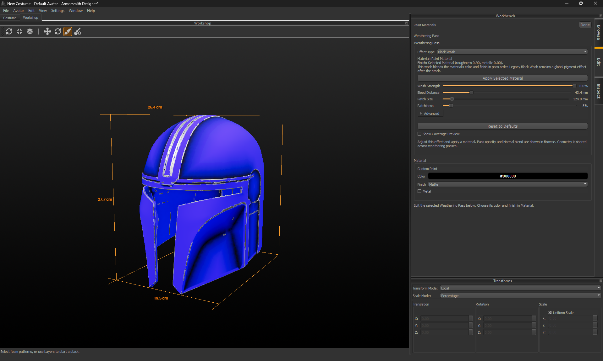

<Info>
These instructions describe the **Paint Materials** workflow for **Armorsmith Designer 2.1.2.0**. Check your installed build if you see different controls. This guide covers Weathering Passes, not the older global weathering controls.
</Info>

Use a **Weathering Pass** to add a procedural finish above an existing Paint Pass. **Black Wash** emphasizes recessed areas; **Edge Wear** highlights exposed convex edges. You can put both above your base paint and adjust them independently.

*Black Wash adds a weathered finish to a painted helmet. This capture shows an earlier arrangement of the weathering controls; use the labels described below for the current build.*

## Add a Weathering Pass

1. In **Workshop**, select the workspace with your painted model.
2. Open **Workbench → Browse → Material Passes**.
3. Choose **Add Pass → Weathering Pass**. Select the new pass in the stack.
4. Open **Workbench → Edit** and use **Effect Type** to choose **Black Wash** or **Edge Wear**.
5. Adjust the effect settings. To change the appearance, choose **Color**, **Finish**, and **Metal** under **Material**, then click **Apply Selected Material** in the Weathering Pass controls.
6. Return to **Browse** to adjust pass **Opacity**, reorder the pass, or hide it temporarily for comparison.

Weathering is blended with the visible passes below it. Selecting or adjusting a Weathering Pass does not turn it into a brush: use a separate **Paint Pass** for hand-painted color.

## Add grime with Black Wash

Choose **Effect Type → Black Wash** to darken crevices and add varied dirt across the model.

| Setting | What it changes |
| --- | --- |
| **Wash Strength** | Overall strength of the grime. Set it to 0% to remove the visible contribution. |
| **Bleed Distance** | How far the wash spreads from recesses, in model millimetres. |
| **Patch Size** | Size of broad dirty or clean patches. It has no effect when Patchiness is 0%. |
| **Patchiness** | Variation in wash coverage. At 0%, the wash follows a smooth curvature-based result. |

Expand **Advanced** for **Bleed Softness** (how gradually grime fades from recesses), **Grain Amount** and **Grain Size** (fine pigment texture), and **Edge Wipe** (how much wash is removed from exposed convex rims).

Start with a moderate **Wash Strength** and a small **Bleed Distance**. Increase Patchiness only after the smooth wash looks right; a little unevenness is usually easier to control than a heavily broken-up mask.

## Reveal edges with Edge Wear

Choose **Effect Type → Edge Wear** to show a contrasting material on exposed edges. Try a lighter color and a metallic finish if you want the effect of scuffed paint revealing metal beneath.

| Setting | What it changes |
| --- | --- |
| **Wear Strength** | Amount of the selected material visible inside worn regions. It does not reshape the region boundary. |
| **Relative Width** | Width of the curvature-based wear band. **1x** uses the saved Edge Wear Shaping response. Smaller values narrow the band; larger ones broaden it. It is a relative control, **not millimetres**. |
| **Width Variation** | Adds broader variation to the band's width. At **0%**, the base band stays smooth. High values can narrow sections into gaps. |
| **Width Frequency** | Controls the spacing of the width variations along an edge. Lower values make broad waves; higher values make tighter waves. It has no effect at 0% Width Variation. |
| **Chip Size** | Physical size, in millimetres, of small nicks along the band boundary. |
| **Chip Amount** | Strength of the small boundary nicks. At **0%**, the chips are disabled. |

<Tip>
For a clean exposed-edge line, first set **Width Variation** and **Chip Amount** to 0%. Adjust **Relative Width**, then add a little Width Variation and finally a little Chip Amount. Use Wear Strength to control the material's visibility without changing the shape of the edge.
</Tip>

Width Variation and Chip Amount are different: the first bends the broad boundary, while the second creates fine interruptions along it. **Width Frequency** changes how often the broad variations occur; **Chip Size** changes the scale of the fine detail.

## Refine the shared curvature response

In **Browse → Material Passes**, expand **Curvature Properties** if you need to refine how the model's bends are recognized.

Under **Edge Wear Shaping**:

- **Low Threshold** determines where convex wear begins. Raise it to ignore weaker bends.
- **High Threshold** determines where wear becomes fully covered. Raising it can make a thinner, softer band.
- **Falloff** adjusts the transition between weak and strong convex bends.

These settings affect **all Edge Wear passes on the selected paint asset** and update without a curvature rebake. They are not per-pass controls.

**Rebake Curvature** recalculates the underlying curvature data when you change the sampling settings. This is separate from ordinary Wear Strength, Relative Width, and mask-detail adjustments. Use **Use Default Curvature** to restore the standard curvature settings if an experiment produces an unwanted result.

For routine finishing, leave the advanced curvature controls at their defaults and adjust each Weathering Pass first.

## Check the layer order and save

A useful starting stack, from top to bottom, is **Edge Wear**, **Black Wash**, and your base **Paint Pass**. You can also insert a **Decal Pass** to add a logo or insignia.

1. Toggle individual passes off and on to see what each contributes.
2. Adjust pass **Opacity** under **Browse** if an effect feels too strong.
3. Orbit the model to inspect recesses, exposed edges, and seams.
4. Choose **File → Save** or press **Ctrl+S**.
5. Reopen a test costume to check that the pass order, materials, and effect settings were saved.

## Troubleshooting

| Symptom | What to check |
| --- | --- |
| Edge wear covers too much of the model | Reduce **Relative Width** and, if necessary, raise **Low Threshold** in Edge Wear Shaping. |
| The wear band looks irregular before adding chips | Set **Width Variation** to 0% to remove broad shape changes. |
| Small nicks are too coarse | Reduce **Chip Size**, or reduce **Chip Amount** to soften the breakup. |
| Changing Width Frequency seems to do nothing | Width Frequency needs nonzero **Width Variation**. |
| Black wash looks too mottled | Reduce **Patchiness** and **Grain Amount**. |
| Editing one curvature control changes several Edge Wear passes | **Edge Wear Shaping** is shared by the paint asset. Use individual pass controls for separate finishes. |

For paint and material-pass basics, see [Paint materials on a model](/painting/paint-materials). For a first painting exercise, see the [beginner tutorial](/painting/paint-tutorial).
